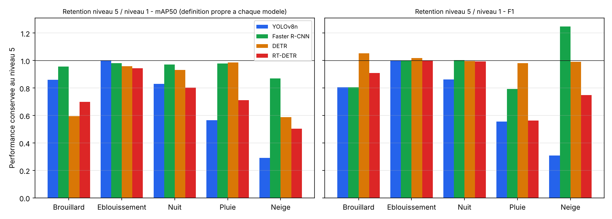

# Domain shift en detection d'objets : quelle famille de modeles resiste le mieux aux degradations ?

Projet de cours (ESMT Dakar, Data & IA, 2024-2025, encadre par le Dr Mohamed Keita) sur le **changement de domaine (domain shift)** : un modele entraine sur des images en conditions normales est evalue sur des images degradees. L'objectif demande etait de determiner **quelle famille de modeles se degrade le moins** : CNN une etape (YOLOv8), CNN deux etapes (Faster R-CNN) ou transformers (DETR, RT-DETR). Les quatre detecteurs sont entraines sur le meme jeu de 777 images, puis evalues sur 25 versions perturbees du jeu de test : **5 perturbations (brouillard, eblouissement, nuit, pluie, neige) x 5 niveaux d'intensite**.



## Question

Quand la distribution des images change a l'inference (meteo, luminosite), quelle famille de detecteurs garde le mieux ses performances ? Pour une camera embarquee, la stabilite compte autant que le score en conditions ideales. La comparaison porte sur la **perte entre le niveau 1 et le niveau 5**, pas sur le meilleur score absolu.

## Donnees

Jeu **Cityscapes** (scenes urbaines filmees depuis une voiture dans 50 villes europeennes, utilise en conduite autonome), dans une version particuliere : des domaines degrades (brouillard, etc.) y ont ete generes a partir des images d'origine, avec des annotations propres au projet.

- **777 images annotees, 5 classes** : 0 plaque d'immatriculation, 1 telephone a l'oreille, 2 absence de ceinture, 3 presence de ceinture, 4 pare-brise.
- **Decoupage YOLOv8** : 610 train (78,5 %), 67 val (8,6 %), 100 test.
- **Decoupage Faster R-CNN, DETR, RT-DETR** : 677 train (87,1 %), 100 test (12,9 %).
- **Dossier `results`** : 25 sous-dossiers (`fog_level1` a `fog_level5`, idem pour `glare`, `night`, `rain`, `snow`), chacun avec 500 images et des annotations en 5 formats (YOLO, COCO, CSV, JSON, VOC), soit 12 500 images au total.
- Les images ne sont pas distribuees dans ce depot : la licence de Cityscapes encadre la redistribution (usage non commercial, telechargement via le site officiel).

## Modeles

| Modele | Type | Entrainement |
|---|---|---|
| YOLOv8n (Ultralytics) | une etape (CNN) | 50 epochs, 640 px, GPU |
| Faster R-CNN (torchvision) | deux etapes (CNN) | 5 epochs |
| DETR (resnet-50, Hugging Face) | transformer | 10 epochs, CPU |
| RT-DETR (r50vd, Hugging Face) | transformer temps reel | 10 epochs, CPU |

## Resultats

Chiffres extraits du notebook, dans `results/weather_metrics_all_models.csv` (une ligne par modele, perturbation et niveau). La **retention** est la performance du niveau 5 divisee par celle du niveau 1 (1,00 = aucune perte).

Retention du mAP50 (definition propre a chaque modele, voir limites) :

| Perturbation | YOLOv8n | Faster R-CNN | DETR | RT-DETR |
|---|---|---|---|---|
| Brouillard | 0,86 | 0,96 | 0,60 | 0,70 |
| Eblouissement | 1,00 | 0,98 | 0,96 | 0,94 |
| Nuit | 0,83 | 0,97 | 0,93 | 0,80 |
| Pluie | 0,57 | 0,98 | 0,99 | 0,71 |
| Neige | **0,29** | 0,87 | 0,59 | 0,50 |

Lecture par famille :
- **Faster R-CNN est le plus stable** : il conserve 87 % ou plus de sa performance sur les cinq perturbations. Prudence : son "mAP50" maison est un indicateur de type rappel, moins sensible aux degradations que le vrai mAP, ce qui avantage sa retention (limite 1).
- **YOLOv8n est le meilleur sans perturbation** (mAP50 d'environ 0,92) mais s'effondre sous la neige (0,91 -> 0,26) et la pluie (0,83 -> 0,47).
- **DETR** tient bien la pluie et l'eblouissement mais cede sur le brouillard et la neige ; **RT-DETR** perd la moitie de sa performance sous la neige.
- L'eblouissement est la perturbation la moins genante pour tous les modeles.

La presentation ajoute quatre indicateurs (momentum de degradation, coefficient de retention, point de rupture a -20 %, indice de dangerosite relative) qui menent a la meme conclusion.

## Limites (a lire avant d'interpreter les chiffres)

1. **Les metriques ne sont pas comparables entre YOLOv8 et les trois autres modeles.** YOLOv8 utilise le mAP d'Ultralytics. Pour Faster R-CNN, DETR et RT-DETR, le code calcule un "mAP50" maison (part des objets dont la meilleure boite a un IoU >= 0,5) et un "mAP50-95" qui est l'IoU moyen. Le F1 de ces trois modeles ne porte que sur les boites appariees, donc les objets manques et les fausses detections n'y comptent pas : un F1 de 0,99 avec un mAP de 0,5 (RT-DETR) n'a rien de contradictoire avec ces definitions. La **retention d'un modele par rapport a lui-meme** reste lisible ; le classement en valeurs absolues ne l'est pas.
2. **Le tableau "Faster R-CNN par classe" du notebook contient les valeurs de YOLOv8**, saisies a la main (memes chiffres que la sortie YOLOv8). Le vrai Faster R-CNN, a l'epoch 5, donne sur le test : precision 0,983, rappel 0,917, F1 0,944, "mAP50" maison 0,542. La ligne "Faster R-CNN" du tableau global de la presentation (0,939 / 0,893 / 0,918 / 0,921 / 0,757) est donc a corriger.
3. **Colonne YOLOv8 "F1" du graphique final** : ce sont les precisions moyennes, pas le F1.
4. **Fuites de donnees.** Le jeu de validation de YOLOv8 est une copie de 10 % du train. Les meilleurs epochs de DETR et RT-DETR sont choisis sur le jeu de test.
5. **Petits echantillons et une seule execution.** 100 images de test ; la classe "telephone a l'oreille" n'a que 4 exemples en validation ; une graine ; Faster R-CNN entraine sur 5 epochs seulement.
6. Pour Faster R-CNN, un modele est reentraine pour chaque perturbation et niveau, alors que les trois autres sont entraines une fois puis evalues : le protocole n'est pas identique.
7. Les ecarts de quelques points (par exemple retention Faster R-CNN en neige : 0,87 ici contre 81,2 % dans la presentation) viennent d'arrondis ou d'executions differentes et n'ont pas ete reconcilies.

## Structure

```
notebooks/EtudeComparaisonDesModels.ipynb   code et sorties d'origine (chemins relatifs)
results/weather_metrics_all_models.csv      metriques par modele / perturbation / niveau
results/retention_*.csv                     retention niveau 5 / niveau 1
src/compare_models.py                       recalcule la retention et la figure
docs/                                       graphiques
```

## Reproduire

```bash
pip install -r requirements.txt
python src/compare_models.py results/weather_metrics_all_models.csv docs/retention_level5_over_level1.png
```

Pour reentrainer les modeles il faut le jeu de donnees (non distribue) organise en `Data/` (YOLO) et `Data2/` (COCO), et un GPU pour YOLOv8 et Faster R-CNN.

## Pistes

- Evaluer les quatre modeles avec le meme code (pycocotools : mAP COCO, rappel et precision reels).
- Choisir les epochs sur une validation separee, repeter avec plusieurs graines.
- Ajouter la vitesse d'inference et la taille des modeles.

## Licence

MIT (code). Donnees : voir section Donnees.
